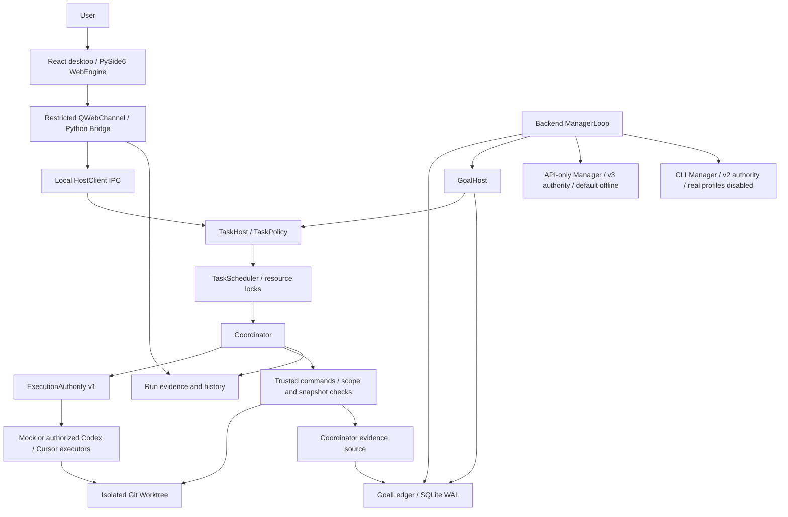

# Dual Agent Studio

A Windows desktop workspace for orchestrating AI coding agents with trusted verification.

[简体中文](README.zh-CN.md) · [Get started](docs/getting-started.md) · [Architecture](docs/architecture.md) · [Security](docs/security.md)


**Source development preview.** GUI **v0.14.1**, with the **v0.15 Phase B2.2-A** backend. B2.2-A completed offline engineering acceptance; **B2.2-B live API integration has not been run**. No installer or stable binary release is offered. A project license has not been selected.


Actual Qt desktop, captured on 2026-10-16. This is a historical real CLI run displayed read-only; publishing this source did not rerun it. Four Diff entries represent repeated snapshots of one source file. [All screenshots and provenance](docs/screenshots.md).

## Overview

Dual Agent Studio coordinates development, review and acceptance in a local Windows workspace. An executor can implement a bounded change while another coding agent reviews it. The Python coordinator independently checks the allowed changes and runs trusted verification commands: a model's claim of success cannot set `verified`.

The desktop shows tasks, execution phases, diffs, usage and evidence. The experimental backend Manager proposes a plan and decisions; GoalLedger persists work and identities; GoalHost dispatches through the existing TaskHost and Scheduler. Manager orchestration currently has a Python API, **not a desktop Manager control panel**. This preview suits developers studying offline orchestration, verification boundaries and Windows agent integration.

## Features and evidence

| Capability | Status | Boundary |
| --- | --- | --- |
| Desktop task submission, history, Diff / Inspector | Available | v0.14.1; built-in Mock rehearsal works without model credentials |
| Codex development + Cursor review / acceptance adapters | Available / historical real validation | New real runs need separate execution authorization; no live agent ran for this publication |
| Scheduler, resource conflict locks, Git Worktrees | Offline validated | Isolation for collaboration, not an OS sandbox |
| Independent verification and RSA execution authorization | Offline validated | Signed scope / budget and fresh tool evidence; no production keys included |
| GoalLedger (SQLite WAL) and GoalHost | Offline validated | Backend service; recovery fails closed for unknown effects |
| ManagerLoop planning, dispatch, review, retry and replan | Offline validated | Fake providers / Fake executors; production result inheritance remains blocked |
| API-only Manager: OpenAI / DeepSeek Responses | Experimental, offline validated | Five API modules; fixed provider profiles and v3 independent signature; no live API acceptance |
| CLI Manager transport | Experimental | Separate v2 Manager authorization; real Codex / Cursor Manager profiles remain disabled |
| Cross-session automatic handoff | Planned | Not implemented |

### API-only Manager (B2.2-A)

`api_profiles.py`, `api_protocol.py`, `api_http.py`, `api_authorization.py`, and `api_transport.py` are included with their safety tests. OpenAI and DeepSeek have distinct fixed endpoint/model profiles and provider field allowlists; both use the Responses parser and domain validation. Requests have empty tools and `tool_choice=none`; unexpected tool output is rejected. This is an API adapter, separate from Codex / Cursor CLI Manager.

The independent **v3 `manager_call` signature** binds backend kind, provider, endpoint, model, protocol, data scope and profile hash. Existing **v2 CLI Manager** and **v1 Executor** authorities keep separate purposes and ledgers. Production trust roots are empty in this source. The default API path is offline-only; it does not load a user API key to run the demo. An unknown sent result is recorded for reconciliation and is not automatically resent.

The B2.2-A acceptance added **59 offline engineering tests**, using FakeHTTP, scripted TLS/socket responses and temporary fixture executors. They test real adapter code paths, **not real models or provider availability**. [Validation and current limits](docs/development-status.md).

## Architecture



The Manager cannot grant execution permission or manufacture trusted evidence. [Architecture and authority boundaries](docs/architecture.md).

## Getting started (Windows)

Use Windows 10/11, Python **3.13**, Git and Node.js **22.12+**. These are source build instructions, not an installer. Other Windows machines still need validation.

```powershell
git clone https://github.com/kun520c/dual-agent-studio.git
cd dual-agent-studio
py -3.13 -m venv .venv
.\.venv\Scripts\python.exe -m pip install -r requirements.txt
npm.cmd ci --prefix design-prototype --registry=https://registry.npmjs.org
npm.cmd run check --prefix design-prototype
npm.cmd run build --prefix design-prototype
npm.cmd test --prefix design-prototype
.\.venv\Scripts\python.exe -B tools/run_offline_checks.py --suite all
.\.venv\Scripts\python.exe -B desktop-validation/run.py --state .test-output/gui-state
```

In the Chinese-language desktop: **项目管理 → 创建安全演练 → 新建任务 → Mock → 预检 → 提交**. The rehearsal writes only its fixed sample and runs the built-in trusted check. It needs no API key, signed production grant, Codex or Cursor installation. For a read-only launch, add `--read-only`; that mode does not create a task host. [Detailed setup and troubleshooting](docs/getting-started.md).

The historical `design-prototype` name is retained only as the frontend dependency directory in this export. No prototype app, `node_modules`, prebuilt `frontend/dist` or original run data is tracked. Build frontend assets before launching.

## Project status

- GUI: **v0.14.1**; backend source baseline: **v0.15 B2.2-A**.
- Offline Manager orchestration and B2.2-A engineering acceptance: completed within their documented offline scope.
- B2.2-B real API acceptance: **not executed**. Real CLI Manager isolation / protocol support remains unconfirmed.
- Production multi-task result inheritance: blocked. Automatic cross-session handoff: planned.
- Real automatic repair: not directly accepted; first-pass success with zero repairs is not repair evidence.
- Deployment on a fresh Windows machine and native long-running reliability: still need validation.

## Roadmap

Delivered offline: persistent GoalLedger; GoalHost integration; bounded ManagerLoop; independent CLI/API Manager authority; unknown-result reconciliation.

Planned: specifically authorized live Manager acceptance; production integration / result inheritance; durable cross-session handoff; real repair acceptance; fresh-machine packaging. These are goals, not release promises.

## Documentation

- [Getting started](docs/getting-started.md)
- [Architecture](docs/architecture.md)
- [Development status and validation](docs/development-status.md)
- [Security and reporting](docs/security.md)
- [Screenshots and provenance](docs/screenshots.md)
- [FAQ](docs/faq.md)
- [Contributing](CONTRIBUTING.md)
- [Changelog](CHANGELOG.md)
- [Public export and maintenance](docs/public-export.md)
- [Third-party notices](THIRD_PARTY_NOTICES.md)
- [Explicit public file hashes](PUBLIC_SOURCE_MANIFEST.json)

## Limitations and security

Worktrees, write scopes and Windows process Jobs are not OS sandboxes. Model self-reports cannot replace independent tool verification. Real execution and Manager requests need independent signed authorization. Offline tests do not establish real model performance. Call/time budgets cannot guarantee a monetary cost cap. The project remains in active development; do not use this preview as a production security boundary. [Security details](docs/security.md).

## License

Copyright © 2026 kun520c. All rights reserved. **A project license has not been selected.** Public source visibility is not a general permission to reuse, modify or redistribute the project. Third-party dependencies retain their own licenses. No MIT or Apache project license is implied.
