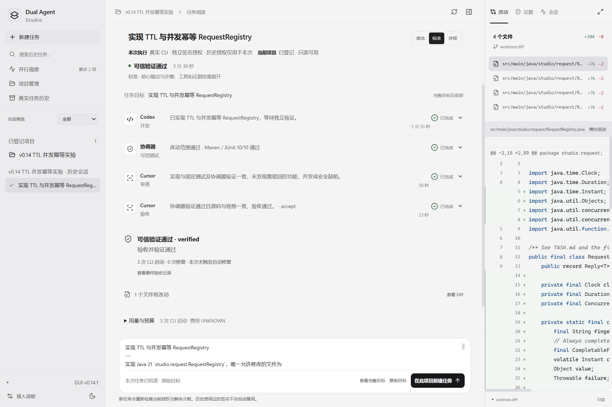
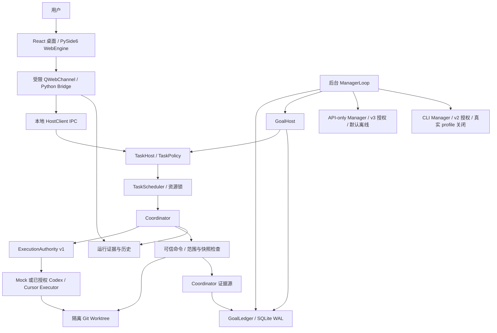

# Dual Agent Studio

面向 Windows 开发者的多 AI Coding Agent 协作桌面工作区，使用独立可信验证确认结果。

[English](README.md) · [安装与离线演练](docs/getting-started.md) · [架构](docs/architecture.md) · [安全边界](docs/security.md)

**源码开发预览**：GUI 仍为 **v0.14.1**，后台为 **v0.15 Phase B2.2-A**。B2.2-A 已完成离线工程验收；**B2.2-B 真实 API 联调尚未执行**。**无安装包、无稳定 Release、仓库不含预构建 `frontend/dist`**——请克隆源码后自行构建前端再启动。尚未选定项目许可证。

**版本口径**：上文 GUI / 后台编号是文档中的产品里程碑；可导入包 `dual_agent.__version__` 当前仍为 **`0.2.0`**，**不等于** GUI 或后台里程碑。本批只澄清文档，不改包内版本常量。



截图来自 2026-10-16 的真实 GUI，展示历史任务，发布本仓库没有重新调用模型。同一文件的四份轮次 Diff 不代表四个业务文件。[四张截图及来源](docs/screenshots.md)。

## 用途与职责

桌面展示任务、阶段、Diff、历史、用量和可信证据。Executor 执行有范围的开发任务，其他 Coding Agent 审查和验收；Python Coordinator 独立运行固定可信命令、检查改动范围和当前快照。模型说“完成”不能直接创建 `verified`。

ManagerLoop 负责提出计划和决策，GoalLedger 持久化目标和身份，GoalHost 复用原有 TaskHost / Scheduler / Coordinator 派工。Manager 目前只有后台 Python API，**没有对应的 GUI 自主管理入口**。适合研究离线协作、执行证据与 Windows 集成的开发者。

## 实现状态

| 能力 | 状态 | 边界（与英文 README 对齐） |
| --- | --- | --- |
| 桌面任务提交、历史、Diff / Inspector、内置 Mock | 已实现 | GUI **v0.14.1**；Mock 安全演练无需模型凭据或生产签名 |
| Codex 开发 + Cursor 审查/验收适配 | 已实现 / 历史真实验证 | 新真实运行需独立执行授权；本仓发布未重跑真人 |
| 调度、资源锁、Git Worktree | 仅离线验证 | 协作隔离，**不是** OS 沙箱 |
| 独立可信验证与 RSA 执行授权 | 仅离线验证 | 签名范围/预算与新鲜工具证据；源码不含生产密钥 |
| GoalLedger（SQLite WAL）与 GoalHost | 仅离线验证 | 后台服务；未知效果恢复失败关闭 |
| ManagerLoop 规划、派工、审查、重试与重规划 | 仅离线验证 | Fake provider / Fake executor；生产成果继承仍阻断 |
| API-only Manager（OpenAI / DeepSeek Responses） | 实验性，仅离线验证 | 五模块 + v3 独立签名；**B2.2-B 真实 API 联调未执行** |
| CLI Manager 传输 | 实验性 | 独立 v2 Manager 授权；真实 Codex/Cursor Manager profile **仍关闭** |
| 跨会话自动交接 | 计划 | 尚未实现 |
| 安装包 / 稳定二进制 Release | 未发布 | 须自行构建 `frontend/dist` 后从源码启动 |

## API-only Manager：B2.2-A

公开源码包含 `api_profiles.py`、`api_protocol.py`、`api_http.py`、`api_authorization.py`、`api_transport.py` 五个新模块及必要安全测试。OpenAI 与 DeepSeek 使用各自固定 endpoint / model profile 和字段白名单，复用 Responses 解析与领域校验。请求空 tools / tool_choice=none，拒绝工具输出和未知响应，不自动重发发送后结果未知的请求。

API 调用使用独立 **v3 manager_call 签名**，绑定 backend kind、provider、endpoint、model、protocol、数据范围和 profile 摘要；与 **v2 CLI Manager**、**v1 Executor** 权限区分。生产信任根为空，默认 API 离线禁网。离线演练不读取真实 API 凭据。

新增 **59 项离线工程测试**覆盖 FakeHTTP、脚本化 TLS/socket、临时 Fake Executor 和真实产品适配代码路径。它们不是 59 次真实模型测试，不证明账户可用性、真实模型效果或实际费用。B2.2-B 未执行，真实自动修复仍未直接验收。

## 架构



**边界**：Manager **不能**授予执行权限，也不能自造可信验收证据。桌面仍是 GUI v0.14.1 任务面；Manager 编排仅后台 Python API，**没有**桌面 Manager 控制台。细节见 [架构说明](docs/architecture.md)（英文图与此同构：[README Architecture](README.md#architecture)）。

## Windows 安装与离线运行

要求 Windows 10/11、Python 3.13、Git、Node.js 22.12+。以下是**源码构建**步骤，不是安装包；全新 Windows 机器仍需部署验收。克隆后必须先通过 `design-prototype` 的 npm 脚本构建出 `frontend/dist`，仓库不跟踪预构建产物。

```powershell
git clone https://github.com/kun520c/dual-agent-studio.git
cd dual-agent-studio
py -3.13 -m venv .venv
.\.venv\Scripts\python.exe -m pip install -r requirements.txt
npm.cmd ci --prefix design-prototype --registry=https://registry.npmjs.org
npm.cmd run check --prefix design-prototype
npm.cmd run build --prefix design-prototype
npm.cmd test --prefix design-prototype
.\.venv\Scripts\python.exe -B tools/run_offline_checks.py --suite all
.\.venv\Scripts\python.exe -B desktop-validation/run.py --state .test-output/gui-state
```

在 GUI 中按 **项目管理 → 创建安全演练 → 新建任务 → Mock → 预检 → 提交** 操作。固定样本不调用真实模型、不需要生产私钥。只读启动加 `--read-only`，不创建任务宿主。`design-prototype` 仅保留前端依赖声明和锁文件；启动前必须构建 `frontend/dist`。[完整说明](docs/getting-started.md)。

## 路线与限制

已完成相应离线基础：持久账本、原宿主集成、有限 Manager 编排、CLI/API 独立签名和未知结果协调。规划：经单独批准的真实 Manager 联调、生产继承、跨会话交接、真实修复验收及跨机打包。

Worktree / write_paths 不是 OS 沙箱；模型自述不是可信验证；次数/时间预算不是费用硬上限。截图中的历史首次通过、零修复不能证明真实自动修复。当前仍处于积极开发阶段。

## 文档

[安装](docs/getting-started.md) · [架构](docs/architecture.md) · [状态与验证](docs/development-status.md) · [安全](docs/security.md) · [FAQ](docs/faq.md) · [贡献](CONTRIBUTING.md) · [变更记录](CHANGELOG.md) · [发布同步](docs/public-export.md) · [第三方声明](THIRD_PARTY_NOTICES.md)

## 许可

Copyright © 2026 kun520c，保留所有权利。**尚未选定项目许可证**。公开可见不等于授予通用使用、修改或再分发许可；第三方依赖遵循各自许可证。本仓库不宣称已经采用 MIT / Apache 等开源许可证。
