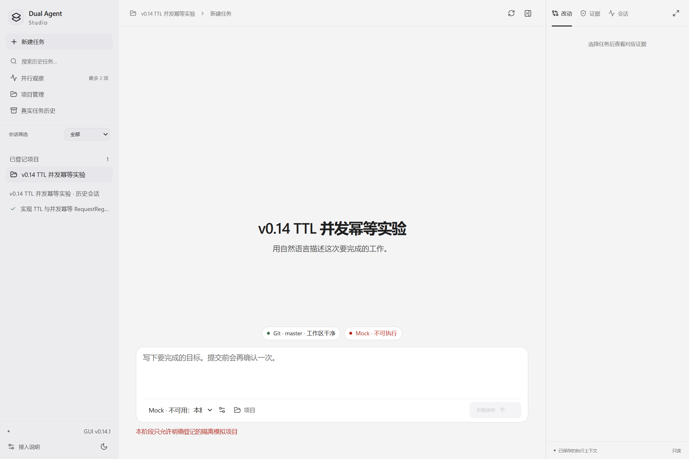
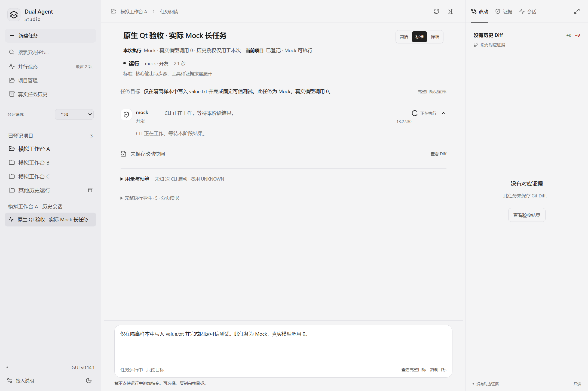
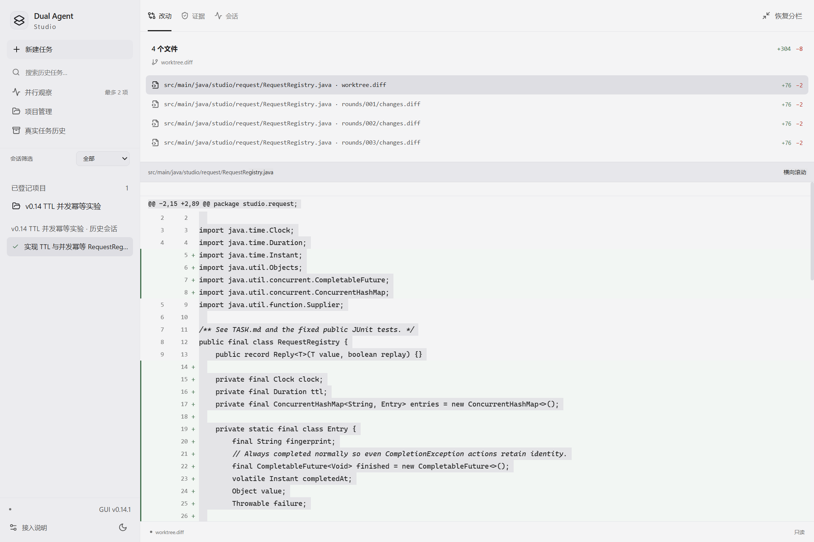

# Actual GUI screenshots

All four images are unmodified Qt WebEngine captures from 2026-10-16, GUI v0.14.1, re-reviewed for this publication. Visible content is limited to product UI, isolated experiment names, relative source paths and task text. No account, credential, authorization signature or private absolute path was seen. Images have been checked for text metadata as well as visible pixels. Original raw runs are excluded.

## Workspace / trusted history

Historical real CLI verification, not rerun for publication. Four Diff entries refer to repeated snapshots of one source file. Zero repair rounds do not prove real automatic repair.

## New task / denied submission

Actual denied Mock permission; a task form does not grant execution permission.

## Mock / Offline Demonstration

**Mock / Offline Demonstration**, not a real model run. The UI itself states zero real model calls.

## Diff / Inspector

Read-only historical Diff, not new execution.

Exact source and SHA-256 for each image are in [PUBLIC_SOURCE_MANIFEST](../PUBLIC_SOURCE_MANIFEST.json). No fabricated interface, AI-generated product screenshot or newly recorded paid-agent session is used.
